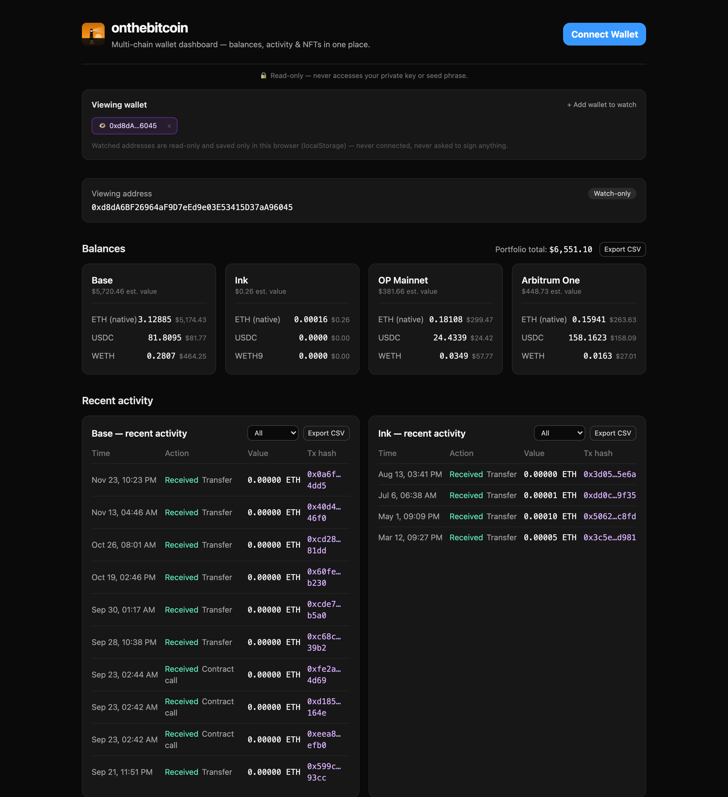

# onthebitcoin — Multi-Chain Wallet Dashboard

A local-first, read-only wallet dashboard by **onthebitcoin**, tracking
balances, activity, and NFTs across **Base**, **Ink (Inkonchain)**,
**Optimism**, **Arbitrum**, and **OpenSea**. Built to demonstrate practical
Web3 frontend work — wallet connect, multi-chain data, and third-party API
integration — and used in daily personal workflow to monitor wallet holdings
across several chains from one screen.


**Live demo:** [onthebitcoin.github.io](https://onthebitcoin.github.io/)

> **For Upwork / client pitches:** "I built onthebitcoin, a read-only
> multi-chain wallet dashboard (React, TypeScript, wagmi/viem, RainbowKit)
> that tracks balances, transaction history, NFTs, and portfolio USD value
> across Base, Ink, Optimism, and Arbitrum — plus watch-only support for any
> address, CSV export, and clean loading/error states throughout. It's live,
> open-source, and something I use myself daily to track my own wallets."

## Screenshot

<!--
  Add a real screenshot (connected wallet, with balances/activity/NFTs
  populated) here before publishing to a portfolio — a populated screenshot
  is the single highest-impact addition to this README.
  Markdown: 
-->

_Screenshot coming soon — see the live demo above in the meantime._

## What it does

- **Connect any wallet** (MetaMask, Coinbase Wallet, Rainbow, WalletConnect...)
  via RainbowKit — or skip connecting entirely and **watch any address
  read-only** by pasting it in. Switch between your connected wallet and any
  number of saved addresses at any time; everything below (balances,
  activity, NFTs) follows whichever one is active.
- **Multi-chain balances**: native ETH plus USDC/WETH balances on Base, Ink,
  Optimism, and Arbitrum, with a one-click chain switch, plus an estimated
  USD value per chain and a portfolio-wide total (CoinGecko prices).
- **Recent activity**: last transactions on Base, Ink, Optimism, and
  Arbitrum — time, action (Sent/Received + decoded method name), value, and a
  link to the block explorer. Filter by Sent/Received per chain, export the
  full list to CSV.
- **NFTs**: image grid of the connected wallet's NFTs on Base, Ethereum,
  Optimism, and Arbitrum, linking out to their OpenSea listing, with a search
  box to filter by name/collection across all four chains at once.
- **Export to CSV**: both the balances table (every chain, every token, with
  USD values) and each chain's activity table export with one click — handy
  for taxes, spreadsheets, or just backing up what you're tracking.
- **Add token to wallet**: one click adds a known ERC-20 (USDC/WETH) to your
  connected wallet's token list via EIP-747 `wallet_watchAsset` — display
  only, cannot move funds or need approval, shown only for the chain your
  wallet is actually active on.
- **Dark mode, responsive** (desktop and mobile), with loading skeletons,
  empty states, and error states with a retry button throughout.
- **No backend, no database** — every screen is a direct, client-side call to
  a public chain RPC or a public API (Blockscout, OpenSea). Nothing is stored
  or sent anywhere except those direct calls.

## Tech stack

| Layer | Choice | Why |
|---|---|---|
| Build tool | Vite | fast dev server, simple config |
| UI | React 19 + TypeScript | type-safe, component-based |
| Styling | Tailwind CSS v4 | utility-first, no separate config file needed |
| Wallet connect | RainbowKit | polished connect UI out of the box |
| Chain interaction | wagmi v3 + viem | React hooks for balances, chain switching, contract reads |
| Transaction history | Blockscout API v2 | public, no API key, same schema across Base, Ink, Optimism, Arbitrum |
| NFTs | OpenSea API v2 | official NFT ownership data, free instant API key |
| Portfolio value | CoinGecko public API | free, no API key, ETH + USDC prices |
| Data fetching/caching | TanStack Query | loading/error states, caching, retry, built into wagmi |

## Project structure

```
public/
  favicon.ico, icons/           favicon + apple-touch-icon, generated from images/otb-r1c.png
  images/otb-r1c.png            onthebitcoin logo (header + favicon source)
  images/onthebitcoin-banner@2x.png   onthebitcoin brand banner (shown pre-connect)
src/
  wagmi.ts         wagmi/RainbowKit config: chains, connectors, WalletConnect id
  tokens.ts        known ERC-20 addresses per chain (Base, Ink, Optimism, Arbitrum)
  blockscout.ts    Blockscout API v2 client (recent activity, 4 chains)
  opensea.ts       OpenSea API v2 client (NFTs by account)
  prices.ts        CoinGecko client for ETH/USDC prices (portfolio USD value)
  viewingAddress.tsx  multi-wallet state: connected wallet vs watched addresses (localStorage)
  WalletSwitcher.tsx  UI to add/remove/switch watched addresses
  csv.ts           tiny client-side CSV export helper (no dependency)
  ui.tsx           shared Skeleton / ErrorState / EmptyState components
  Balances.tsx     native + token balances section, chain switcher
  Activity.tsx     recent transactions table, per chain
  Nfts.tsx         NFT grid, per chain
  App.tsx          page layout, header/footer, onthebitcoin branding, wires sections together
  main.tsx         React root, wagmi/query/RainbowKit providers
```

## Run locally

```bash
npm install
npm run dev
```

Open the printed localhost URL (defaults to `http://localhost:5173`).

### Build for production

```bash
npm run build
npm run preview
```

## Deployment

This repo deploys automatically to **GitHub Pages** via GitHub Actions
(`.github/workflows/deploy.yml`): every push to `main` runs `npm ci && npm run
build` and publishes `dist/` — see the live demo link above.

To set this up on your own fork/repo:

1. In the repo's GitHub Settings → Pages, set **Source** to "GitHub Actions".
2. In Settings → Secrets and variables → Actions, add the two secrets from
   `.env.example` (`VITE_WALLETCONNECT_PROJECT_ID`, `VITE_OPENSEA_API_KEY`).
3. Push to `main` (or re-run the workflow manually) — Actions builds and
   deploys automatically.

### Alternative: Vercel

Works just as well if you prefer Vercel's workflow:

1. Go to [vercel.com/new](https://vercel.com/new), import the repo — Vercel
   auto-detects the Vite framework preset, no config needed.
2. Add the same two environment variables in the Vercel project settings.
3. Deploy. Every push to `main` redeploys automatically.

## Environment variables (`.env.local`)

```bash
# WalletConnect Cloud project id — free at https://cloud.walletconnect.com
# Only needed for the WalletConnect (QR / mobile wallet) connector.
# Injected wallets (MetaMask, Coinbase Wallet, Rabby...) work without it.
VITE_WALLETCONNECT_PROJECT_ID=your_id_here

# OpenSea API key — required for the NFT section to load real data.
# Get an instant free key (no signup) per https://docs.opensea.io/reference/api-keys,
# or sign up at https://opensea.io/settings/developer for a longer-lived one.
VITE_OPENSEA_API_KEY=your_key_here
```

Without `VITE_OPENSEA_API_KEY` the NFT section shows a clear placeholder
instead of silently failing (and distinguishes "key missing" from "key
rejected / expired" if one is set but invalid). Without
`VITE_WALLETCONNECT_PROJECT_ID` everything still works via injected wallets;
only WalletConnect itself is disabled.

## Supported chains

| Chain | Chain ID | Explorer used |
|---|---|---|
| Base | 8453 | base.blockscout.com |
| Ink (Inkonchain) | 57073 | explorer.inkonchain.com |
| Optimism | 10 | explorer.optimism.io |
| Arbitrum One | 42161 | arbitrum.blockscout.com |
| Ethereum (NFTs only) | 1 | opensea.io |

All four L2s share the same Blockscout v2 API schema, so `blockscout.ts`
handles activity for all of them with one typed client — adding a chain is
just a new entry in its `BLOCKSCOUT_CHAINS` map (plus `tokens.ts` for known
token addresses, and the chain array in `Balances.tsx`/`Activity.tsx`/
`Nfts.tsx`).

## Notable implementation decisions

- **No `<StrictMode>`.** In dev, StrictMode double-invokes effects, which
  makes wagmi's injected connector fire two `eth_requestAccounts` calls.
  MetaMask/Coinbase Wallet only resolve the first, so the second hangs
  forever — this looks exactly like a stuck "Confirm connection" even after
  approving in the extension.
- **wagmi v3's `useBalance` only returns the native balance** (no `token`
  option, no `.formatted` field, unlike wagmi v2). ERC-20 balances are read
  via `useReadContract` + viem's `erc20Abi`, formatted with `formatUnits`.
- **One Blockscout client covers all four L2s.** Base, Ink, Optimism, and
  Arbitrum all run public Blockscout instances with the same v2 API schema,
  so a single typed client handles transaction history for all of them — no
  custom indexer, no API key. Note: Optimism's instance moved domains, from
  `optimism.blockscout.com` (now 301-redirects) to `explorer.optimism.io`.
- Every data section (Balances, Activity, NFTs) independently handles
  loading (skeletons), empty, and error (with retry) states, so a slow or
  failing third-party API never breaks the rest of the page.
- **Portfolio USD value is best-effort, never blocking.** Prices come from
  CoinGecko's free public endpoint (no key). If that request fails, balances
  still display normally — only the `$` figures fall back to "—" and a small
  "(prices unavailable)" note appears next to the portfolio total. WETH/WETH9
  are priced 1:1 with ETH (correct assumption for a wrapped-native token);
  USDC uses CoinGecko's own USDC price rather than a hardcoded $1, since
  stablecoins do de-peg briefly in practice.
- **Multi-wallet is watch-only by construction.** `viewingAddress.tsx` just
  resolves one `address` — either the connected wallet's, or a saved one from
  `localStorage` — and every section reads balances/activity/NFTs for
  whichever address that is. Watched addresses are never passed to a
  connector, never asked to sign anything; "Switch chain" is hidden for them
  since chain-switching only means something for an actual connected wallet.
- **"Add to wallet" is read-only too, despite touching the wallet.**
  `wallet_watchAsset` (EIP-747) only asks the wallet to *display* a token —
  it's the same permission level as adding a bookmark, not a transaction, so
  it needs no confirmation dialog in this app and carries no custody risk.
  It's only shown next to tokens on the chain the connected wallet is
  actually active on (watch-only addresses never show it, since there's no
  wallet to update).

## Possible next steps

- Code-split RainbowKit's wallet/locale chunks (currently one ~900KB bundle;
  works fine, just not minimal).
- Add Ink NFT support once a reliable Ink-native NFT indexer is available.
- Light mode toggle (currently dark-only by design).
- Quick links out to a swap aggregator (e.g. Jumper, LI.FI) for a held
  token — pure navigation, no swap logic in-app.

## License

MIT — free to use, fork, or adapt.
